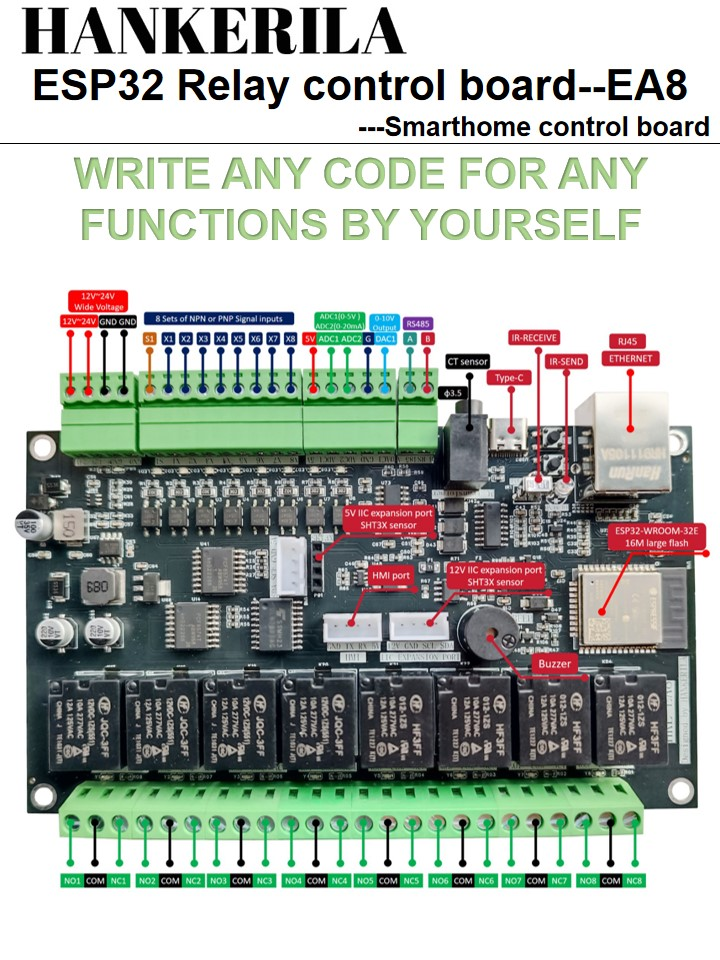

# Hardware
Board Model: HKL-EA8
In Arduino IDE: NodeMCU-32S


## Example code
https://github.com/hankerila-MA/HKL-EA8

# Build and flash
Requires [Arduino CLI](https://arduino.github.io/arduino-cli/) (`winget install ArduinoSA.CLI`), the ESP32 core, the PCF8574 library and IRremoteESP8266 (split ACs over IR):

```bash
arduino-cli config init
arduino-cli config add board_manager.additional_urls https://espressif.github.io/arduino-esp32/package_esp32_index.json
arduino-cli core update-index
arduino-cli core install esp32:esp32
arduino-cli lib install "PCF8574 library"
arduino-cli lib install IRremoteESP8266
```

Compile, flash over USB (replace `COMx` with the board's port, see `arduino-cli board list`) and open the serial log:

```bash
arduino-cli compile --fqbn esp32:esp32:nodemcu-32s .
arduino-cli upload  --fqbn esp32:esp32:nodemcu-32s -p COMx .
arduino-cli monitor -p COMx -c baudrate=115200
```

# Remote access (from outside the home network)
The web UI has no login and no HTTPS. Anyone who reaches it can switch the unit, change the timer and rules, toggle the relays and write raw Modbus registers (`/api/raw`, `/api/addr`). **Do not port-forward the router to `192.168.1.200`.** Basic auth on the ESP32 would not help, because the password would travel in plain text. TLS on the ESP32 is slow and needs certificates on the device.

Keep the ESP32 LAN-only and get into the LAN through a VPN. Options, best first:

1. **Tailscale** (WireGuard-based, free for personal use). The ESP32 can't run it, so install it on an always-on device at home (Raspberry Pi, NAS or a router that supports it) and enable **subnet routing** for `192.168.1.0/24`. With the Tailscale app on the phone, `http://192.168.1.200/` works from anywhere. No open ports, works behind CGNAT, traffic is encrypted.
2. **WireGuard on the router** (OpenWrt, Keenetic, MikroTik, ASUS, FritzBox and others support it). Same result with no third-party service. It opens one UDP port, but WireGuard doesn't answer unauthenticated packets, so the port looks closed to scanners. Needs a public IP (not CGNAT) and dynamic DNS if the IP changes.
3. **Cloudflare Tunnel + Cloudflare Access**, for a normal browser URL without a VPN app. Run `cloudflared` on a home machine pointing at `http://192.168.1.200` and put an Access policy in front that allows only your email (one-time code login). Cloudflare handles HTTPS and login. Depends on Cloudflare and needs a domain.

The planned Telegram bot follows the same rule: the ESP32 only makes outgoing connections, so nothing is exposed. Check the Telegram user ID on every message.

# Plans to develop the app

1. by pass as air cond.
2. control air conditioners over IR — done (Split ACs tab, up to 8, one per relay)
3. vent for basement
4. connect to Telegram bot
5. fix timer to be able to schedule on in one day and off in next day

